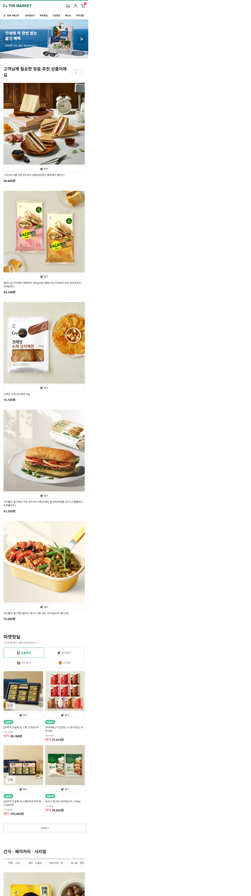
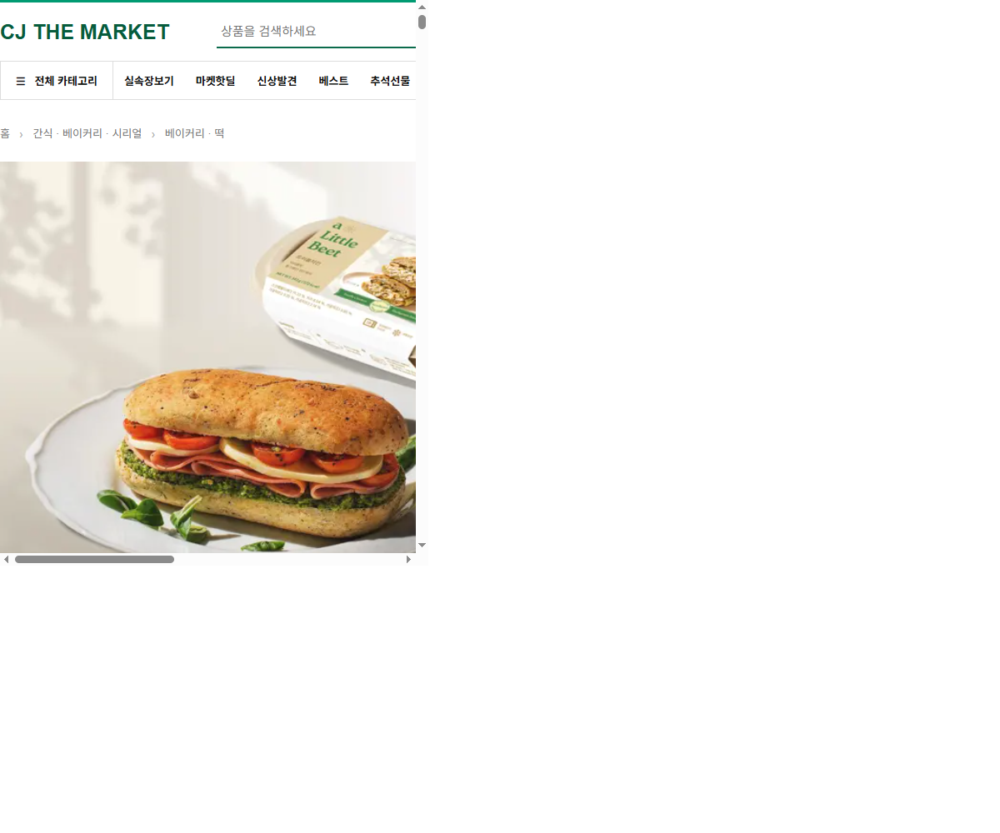

# CJ THE MARKET 클론 | 쇼핑몰 웹 퍼블리싱

CJ THE MARKET의 화면 구성을 참고해 메인 페이지와 상품 상세페이지를 구현한 개인 프로젝트입니다.
HTML·CSS로 쇼핑몰 화면을 구성하고, JavaScript로 **JSON 기반 상품 목록 출력, 배너 슬라이드, 수량에 따른 금액 계산**을 구현했습니다.
메인 페이지에는 768px 이하 모바일 화면에 맞춘 반응형 레이아웃을 적용했습니다.

## 📌 프로젝트 소개

HTML, CSS, JavaScript를 활용하여  
쇼핑몰 메인 페이지와 상품 상세페이지를 구현했습니다.

## 🛠 사용 기술

- HTML5
- CSS3
- JavaScript
- JSON
- Git / GitHub

## ✨ 주요 기능

- 메인 배너 슬라이드
- 상품 리스트 출력
- JSON 데이터를 활용한 상품 렌더링
- 상품 상세페이지
- 메인 → 상품 상세페이지 이동
- 수량 선택 기능
- 모바일 반응형 레이아웃

## 📱 반응형 웹

PC와 모바일 화면 크기에 맞춰  
레이아웃이 변경되도록 제작했습니다.

- **진행 기간:** 2026.08
- **프로젝트 유형:** 개인 프로젝트
- **사용 기술:** HTML5 · CSS3 · JavaScript(ES6) · JSON · Git / GitHub
- **GitHub:** https://github.com/hyeran712/html_0827

## 화면 미리보기

### PC 메인


### 모바일 메인


### 상품 상세페이지


## 프로젝트 개요

쇼핑몰의 상품 탐색 흐름을 이해하고, 화면 구성과 데이터 처리를 연결하는 데 초점을 맞췄습니다.

- **페이지:** 메인(`index.html`), 상품 상세(`sub.html`)
- **상품 데이터:** JSON 파일 5개, 총 33개 상품
- **카테고리:** TOP PICK 5개 · 핫딜 4개 · 간식·베이커리 8개 · 과일·채소 8개 · 만두 8개
- **반응형 적용:** 메인 페이지, 화면 너비 768px 이하

## 주요 기능과 구현 방법

### 1. JSON 기반 상품 목록 렌더링

상품 정보를 카테고리별 JSON 파일로 분리하고, `fetch()`로 불러온 데이터를 `forEach()`로 순회하며 상품 카드로 출력했습니다.

- 상품명·가격·이미지·식별자를 데이터로 관리
- 핫딜 상품에는 정가·할인율을 추가해 할인 정보 표시
- `toLocaleString()`으로 가격에 천 단위 구분 기호 적용

상품 정보와 화면 구조를 분리해, 상품명·가격·이미지를 변경할 때 JSON 데이터를 수정할 수 있도록 구성했습니다.

### 2. 메인 배너 슬라이드

배너 4개의 이미지와 문구를 배열로 관리하고, 현재 인덱스에 따라 화면을 갱신했습니다.

- 3초 간격 자동 전환
- 이전·다음 버튼으로 수동 전환
- `1 / 4` 형태의 현재 배너 위치 표시
- 마지막 배너와 첫 번째 배너 사이의 순환 이동

### 3. 상품 상세페이지와 수량·금액 연동

TOP PICK 상품을 누르면 상품 상세페이지로 이동하도록 연결했습니다. 상세페이지에서는 수량 변경과 금액 계산을 구현했습니다.

- `+` / `−` 버튼으로 상품 수량 변경
- 수량 변경 시 옵션 금액과 합계 금액을 함께 갱신
- 수량이 1개 미만으로 내려가지 않도록 제한

현재 상세페이지는 하나의 고정 상품을 보여주는 구조이며, 상품별 정보 연결은 향후 개선 항목으로 남겨두었습니다.

### 4. 메인 페이지 모바일 반응형

모바일용 스타일을 `css/mobile.css`로 분리하고, 768px 이하에서 콘텐츠 배치와 메뉴 구성을 조정했습니다.

- **헤더:** 검색창과 회원 메뉴를 숨기고, 헤더 높이와 아이콘 간격 조정
- **탐색 메뉴:** 내비게이션과 카테고리 메뉴에 가로 스크롤 적용
- **상품 목록:** TOP PICK과 일반 상품은 1열, 핫딜 상품은 2열로 재배치
- **배너:** 높이·제목 크기·이동 버튼 위치를 모바일 화면에 맞게 조정
- **이미지와 푸터:** 상품 이미지 크기와 비율을 조정하고, 푸터 정보를 세로로 배치

화면의 크기뿐 아니라 상품을 읽고 메뉴를 탐색하는 방식까지 고려해 모바일 레이아웃을 구성했습니다.

## 파일 구조

```text
├── index.html        # 메인 페이지
├── sub.html          # 상품 상세페이지
├── css/
│   ├── reset.css     # 기본 스타일 초기화
│   ├── common.css    # 헤더·푸터 공통 스타일
│   ├── main.css      # 메인 페이지 스타일
│   ├── sub.css       # 상품 상세페이지 스타일
│   └── mobile.css    # 메인 페이지 모바일 스타일
├── js/
│   ├── main.js       # 배너 슬라이드·상품 목록 렌더링
│   └── sub.js        # 수량 변경·금액 계산
├── json/             # 카테고리별 상품 데이터 5개
└── img/              # 상품·배너 이미지 및 화면 캡처
```

## 배운 점

- **데이터와 화면의 분리:** 상품 정보를 JSON으로 관리하며, 반복되는 HTML을 데이터 기반으로 출력하는 방식을 익혔습니다.
- **상태와 화면의 연결:** 배너 인덱스와 상품 수량이 바뀔 때 관련 화면을 함께 갱신하는 과정을 경험했습니다.
- **모바일 화면 구성:** PC 화면을 축소하는 데서 나아가, 상품 배치·메뉴 탐색·정보 노출 방식을 조정하는 방법을 배웠습니다.

## 향후 개선

- **상품별 상세 정보:** `sub.html?id=3`처럼 상품 식별자를 전달해 선택한 상품의 정보 표시
- **상세페이지 연결 확대:** TOP PICK 외 카테고리도 상품별 상세페이지로 연결
- **장바구니 기능:** 담기 버튼에 상품 저장과 담은 수량 표시 기능 추가
- **상세페이지 반응형:** 상품 정보와 수량 선택 영역에 모바일 레이아웃 적용
- **데이터 오류 처리:** 상품 정보를 불러오지 못했을 때 안내 메시지 표시

---

이 프로젝트는 학습 목적으로 제작한 비공식 클론 프로젝트입니다. 사용한 상품 이미지·브랜드·상품 정보의 권리는 각 권리자에게 있습니다.
